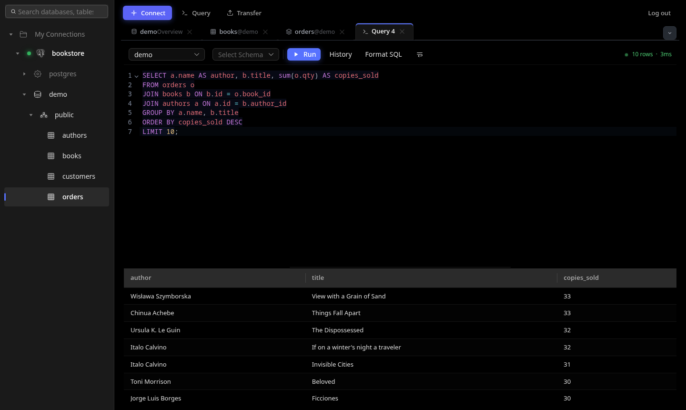
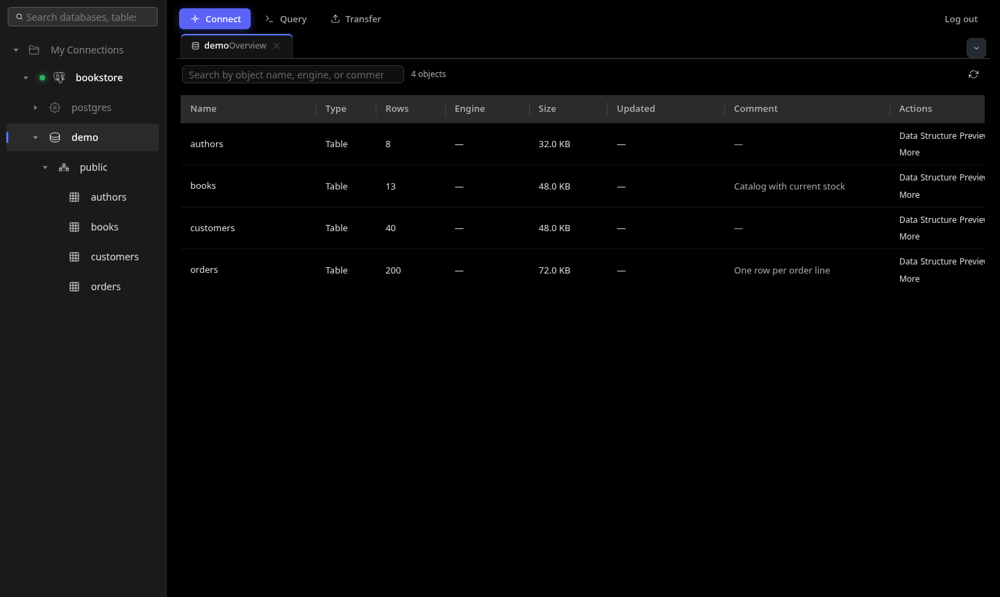
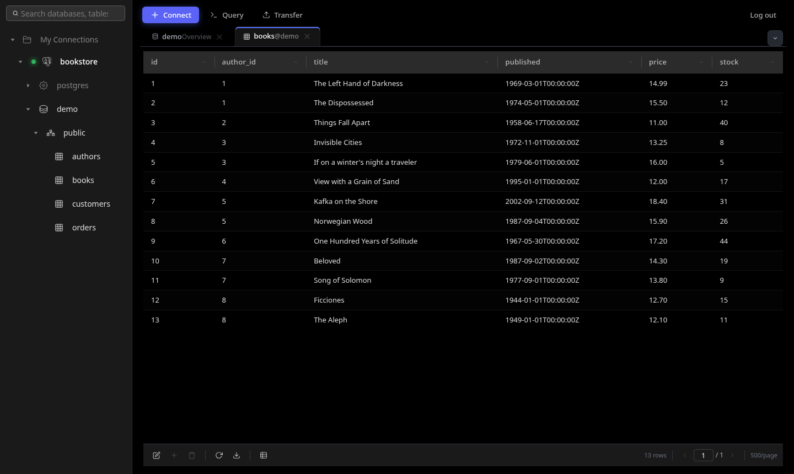
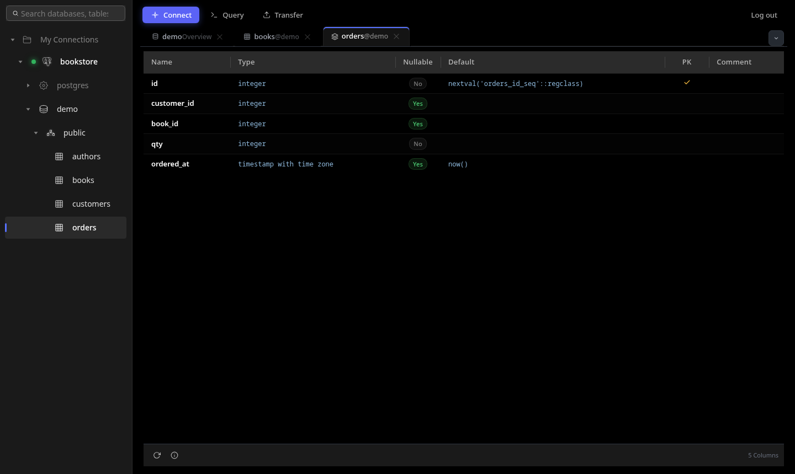
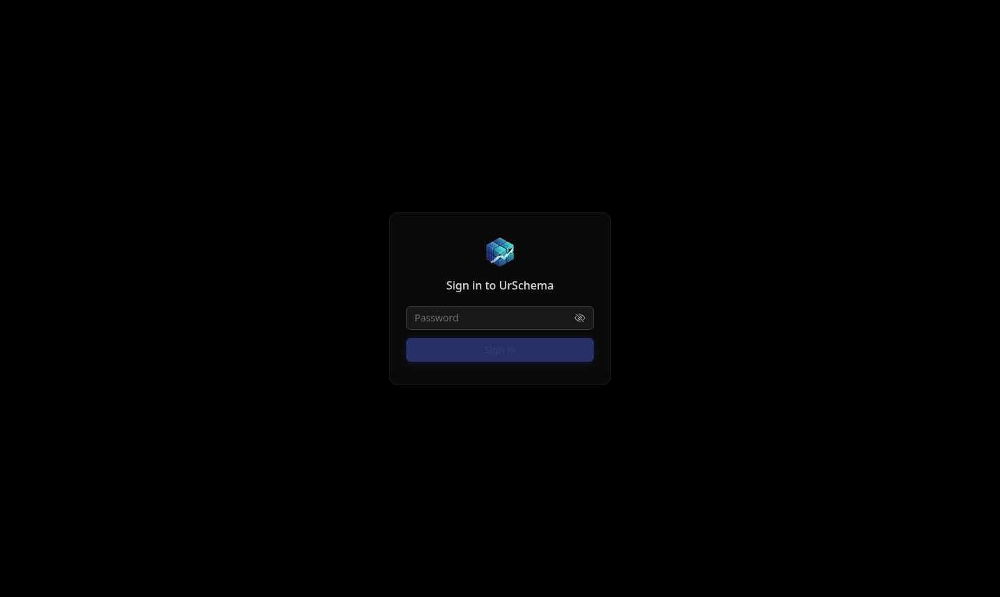

# 🗄️ UrSchema — Database Management Simplified

> A modern, standalone, web-based MySQL/PostgreSQL/SQLite management tool. Lightweight, fast, and built for server operations.

<p align="center">
  
</p>

<p align="center">
  <strong>UrSchema</strong> is a self-contained database management application, providing a visual database experience similar to Navicat / DBeaver.
</p>

<p align="center">
  <a href="https://urschema.app">urschema.app</a>
</p>

<p align="center">
  
</p>

---

## ✨ Features

### Access Control
- 🔑 Optional password login (`URSCHEMA_PASSWORD`) with HttpOnly session cookies and brute-force throttling
- 👀 Read-only mode (`URSCHEMA_READ_ONLY`) for browsing production data safely
- 🔒 Native HTTPS (`URSCHEMA_TLS_CERT` / `URSCHEMA_TLS_KEY`)
- 🏠 Listens on `127.0.0.1` only unless a password is set

See [Security](#-security) for details.

### Connection Management
- 🔐 AES-256-GCM encrypted credential storage (see [Encryption key](#encryption-key))
- 🔌 Multiple concurrent connections with automatic pool recycling
- ✅ Connection testing & one-click save
- 🗂️ Server-side file browser for picking SQLite database files

### Data Operations
- 📊 Paginated data browsing (Grid View)
- 📝 Inline editing — modify data directly in the grid
- 📋 Form View — view and edit individual records vertically
- ➕ Add rows / 🗑️ Delete rows with batch commit
- 🔍 Safe CRUD for tables with and without primary keys

### SQL Query
- ⚡ SQL Editor powered by CodeMirror 6
- 📜 Query history with re-execution support
- 🎯 Multi-statement execution, `Ctrl+Enter` shortcut

### Table Structure Designer
- 🏗️ Visual structure editor (columns, indexes, foreign keys)
- 📝 DDL preview with real-time diff comparison
- 🔄 Auto-generated ALTER TABLE statements

### Import / Export
- 📤 Database export (mysqldump compatible + pure Go fallback)
- 📥 SQL file import with automatic database creation
- 📑 Table-level data export (CSV / JSON / SQL formats)
- 📋 Task management panel with real-time progress tracking
- 🗂️ Server-side file/folder browser for picking import and export paths

### Database Overview
- 📈 Table/view listing with row count, size, and engine info
- 🔎 Object search & filter
- 📄 Quick DDL preview & copy

### Internationalization
- 🌐 UI strings and backend error messages are key-based (vue-i18n on the frontend, an ini-backed catalog on the backend), so adding another language is a matter of adding a translation file — no hardcoded strings.

---

## 🏗️ Architecture

```
┌───────────────────────────────┐
│           Browser             │
│   Vue 3 + Naive UI (SPA)      │
└───────────────┬───────────────┘
                │ HTTP  (POST /api/<method>)
┌───────────────▼───────────────┐
│         Go Backend            │
│  net/http · JSON-RPC dispatch │
│  serves API + static frontend │
└───────────────┬───────────────┘
                │
        ┌───────▼───────┐
        │  MySQL / PG /  │
        │    SQLite      │
        └────────────────┘
```

| Layer | Tech Stack |
|-------|-----------|
| **Frontend** | Vue 3 + Naive UI + CodeMirror 6 + Pinia |
| **Backend** | Go + simplejrpc-go, exposed over a plain HTTP endpoint |
| **Storage** | AES-256-GCM encrypted JSON (connection configs), key from `DB_ENCRYPTION_KEY` or `data/.dbmanager_secret` |

The backend serves both the JSON API (`/api/<method>`) and the built frontend's static assets from a single process — no separate gateway or reverse proxy is required to run UrSchema.

The UI ships with a dark theme by default (no light-mode toggle) and paints its own background, so it renders correctly in any browser tab without relying on a host application.

---

## 📁 Project Structure

```
UrSchema/
├── backend/                 # Go backend
│   ├── handler/rpc/         # JSON-RPC route handlers + HTTP server
│   ├── service/             # Business logic layer
│   ├── pkg/
│   │   ├── auth/            # Password login + sessions
│   │   ├── config/          # Connection store (encrypted)
│   │   ├── db/              # Database abstraction layer
│   │   ├── files/           # File utilities
│   │   ├── rpcutil/         # RPC utilities
│   │   └── sqlguard/        # Read-only mode statement checks
│   ├── i18n/                # Backend i18n
│   ├── Makefile             # Build script
│   └── main.go              # Entry point
│
├── www/                     # Vue frontend
│   ├── src/
│   │   ├── components/      # Core components
│   │   ├── views/           # Page layouts
│   │   ├── stores/          # Pinia state management
│   │   ├── styles/          # CSS design system
│   │   ├── i18n/            # Frontend i18n
│   │   └── utils/           # API client & UI helpers (toasts, dialogs)
│   └── vite.config.js
│
├── docs/                    # Architecture docs + screenshots
├── Dockerfile               # Container image (see Docker below)
└── compose.example.yaml
```

---

## 🚀 Getting Started

### Download a release

Prebuilt linux amd64/arm64 tarballs are attached to each [GitHub Release](https://github.com/virlatinus/UrSchema-Community/releases):

```bash
tar -xzf urschema-linux-amd64.tar.gz
cd app/bin && URSCHEMA_PASSWORD='choose-one' ./main
```

The binary must be started from `app/bin` (it reads `config.json` and `i18n/` from the working directory).

### Docker

```bash
docker run -d --name urschema \
  -p 127.0.0.1:8080:8080 \
  -e URSCHEMA_PASSWORD='choose-one' \
  -v urschema-data:/opt/urschema/data \
  ghcr.io/virlatinus/urschema-community:latest
```

Or build it yourself with `docker build -t urschema .`. See [`compose.example.yaml`](compose.example.yaml) for a Compose setup.

A container has to listen on all interfaces (the image sets `HOST=0.0.0.0`), so **the container refuses to start without a password**: otherwise every other container on the same Docker network could reach an unauthenticated console, whatever the published port's binding. Pass the password with `URSCHEMA_PASSWORD`, or as a Docker secret with `URSCHEMA_PASSWORD_FILE=/run/secrets/<name>`.

The `/opt/urschema/data` volume holds saved connections and, unless you set `DB_ENCRYPTION_KEY_FILE`, the encryption key, so keep it between upgrades.

To reach a database running on the Docker host, use `host.docker.internal` (add `--add-host=host.docker.internal:host-gateway` on Linux).

### Build from source

#### Prerequisites

- **Go** ≥ 1.25
- **Node.js** ≥ 18 + **pnpm**

#### Development

The quickest way to get both servers running is `make start`, which installs any missing Go/pnpm dependencies (`go mod tidy` + `pnpm install`), then launches the backend and frontend dev servers together (via `concurrently`) and wires the frontend proxy to the backend port automatically:

```bash
cd backend
make start        # backend on :8080, frontend on http://localhost:5173
```

#### Using a custom port

The backend defaults to port `8080`. If that port is already taken (e.g. by another service), override it with `PORT`:

```bash
PORT=8888 make start   # backend on :8888, frontend proxy follows automatically
```

To run each server manually instead:

```bash
# 1. Backend dev server (listens on :8080 by default; override with PORT=xxxx)
cd backend
go mod tidy
go run main.go

# 2. Frontend dev server (proxies /api to the backend on the same port, see www/vite.config.js)
cd www
pnpm install
BACKEND_PORT=8888 pnpm dev   # http://localhost:5173, proxying to a custom backend port
```

#### Build & Package

```bash
cd backend

make help         # Show all build targets
make amd64        # Build linux/amd64
make arm64        # Build linux/arm64
make package      # Build frontend + dual-arch packages (tar.gz)
```

Build output structure:
```
build/linux-amd64/
├── app/
│   ├── bin/      # Backend binary + config + i18n
│   └── www/      # Frontend static files, served by the backend
├── data/         # Runtime data
├── logs/         # Logs
└── tmp/          # Temporary files
```

Running the packaged binary (`app/bin/main`) starts an HTTP server that serves both the API and the frontend from `app/www` — open it directly in a browser, no other services required.

#### Access Logging

The backend supports four levels of Apache-style access logging, off by default:

| Flag | Output |
|------|--------|
| `-v` | Apache Common Log Format |
| `-vv` | Apache Combined Log Format |
| `-vvv` | Combined Log Format + request/response headers (plain text, `curl -v` style) |
| `-dump` (or `-dump=text`) | Same as `-vvv`, plus the full request payload and response body — structured JSON by default, or plain text with `-dump=text` |

```bash
./main -v            # PORT=8080 ./main -v
./main -dump          # full request/response dump, JSON
./main -dump=text     # full request/response dump, plain text
```

`-dump` logs full request and response bodies, including the SQL you run and the data it returns. Session cookies, the login password and any JSON field named like `password` or `secret` (such as database passwords in the connection form) are redacted, but treat it as a debugging tool and don't leave it on in production.

---

## 🛡️ Security

UrSchema gives whoever reaches it the same access as the database accounts in its saved connections. Treat it like an SSH session to your database servers.

### Configuration

| Variable | Default | Effect |
|----------|---------|--------|
| `URSCHEMA_PASSWORD` / `URSCHEMA_PASSWORD_FILE` | unset | Require this password to use the UI and API. The `_FILE` form reads it from a file (e.g. a Docker secret). Sessions last 12 hours and are kept in memory, so restarting logs everyone out. |
| `HOST` | `127.0.0.1`, or all interfaces when a password is set | Listen address. A non-loopback address without a password refuses to start. |
| `URSCHEMA_ALLOW_NO_PASSWORD` | `false` | Allow a non-loopback `HOST` without a password. Only for a reverse proxy in front that already authenticates every request; it logs a warning. |
| `PORT` | `8080` | Listen port. |
| `URSCHEMA_READ_ONLY` | `false` | Read-only mode (below). |
| `URSCHEMA_TLS_CERT`, `URSCHEMA_TLS_KEY` | unset | PEM certificate and key paths. When both are set UrSchema serves HTTPS only. |
| `DB_ENCRYPTION_KEY` / `DB_ENCRYPTION_KEY_FILE` | unset | 64 hex chars (32 bytes) used to encrypt saved connections, directly or from a file (below). |
| `URSCHEMA_BASE_PATH` | `/` | URL prefix when a reverse proxy serves UrSchema under a sub-path, e.g. `/db-admin` (below). |
| `URSCHEMA_TRUSTED_PROXIES` | unset | Comma-separated CIDRs or IPs of your reverse proxies. Requests from them take the client address from `X-Forwarded-For` (for login throttling and the access log) and the scheme from `X-Forwarded-Proto`. |
| `URSCHEMA_CONNECTIONS_FILE` | unset | JSON file of connections to show to everyone; they can't be edited in the UI (below). |

### Login: what it does and doesn't cover

UrSchema has **one shared password, not user accounts**. That means:

- No per-user identity, no 2FA, and no per-user audit trail. Logins, failed logins and logouts are logged with the client address (`[auth]` lines), but they can't say *who* signed in.
- Failed logins are throttled per client address: after a failure that address must wait 1 second, doubling with each further failure up to 5 minutes (it gets `429` with `Retry-After` meanwhile). A correct password from any other address is accepted immediately, so a flood of wrong guesses only slows down whoever sends it. There is deliberately no permanent lockout: with one shared password, that would let anyone lock everyone out.
- Behind a reverse proxy, every client shares the proxy's address, so one client's failures make everyone wait. List the proxy in `URSCHEMA_TRUSTED_PROXIES` so throttling uses the client address from `X-Forwarded-For`, or rate-limit logins in the proxy instead (Caddy, nginx and Traefik all can).
- Rotating the password means restarting UrSchema, which also ends all sessions.

That's adequate on a trusted network or behind a VPN, an IP allowlist or an SSH tunnel. Before putting UrSchema next to production on a reachable network, put it behind a reverse proxy that does per-user authentication (oauth2-proxy, Authelia, Cloudflare Access, Tailscale, etc.). The proxy then gives you SSO, 2FA and a per-user access log; keep the UrSchema password as a second layer, or use `URSCHEMA_ALLOW_NO_PASSWORD=true` if the proxy is the only way in.

### Sessions and CSRF

- The session cookie is `HttpOnly` (scripts can't read it) and `SameSite=Strict` (browsers don't send it on requests started from other sites). It's `Secure` when the request arrived over HTTPS, directly or with `X-Forwarded-Proto: https` (only from `URSCHEMA_TRUSTED_PROXIES` when that is set). Its `Path` is `URSCHEMA_BASE_PATH`, so other pages on the same host never receive it.
- `SameSite` treats sibling subdomains as the same site, so the API also rejects cross-origin writes: any non-GET request whose `Sec-Fetch-Site` header (sent by all current browsers) says it came from another origin, or, without that header, whose `Origin` doesn't match the `Host`, gets `403`. This uses Go's `net/http.CrossOriginProtection`.
- All state-changing API calls are `POST`. Requests without browser headers (curl, scripts) are unaffected.
- Behind a reverse proxy, keep the original `Host` header (the default in Caddy and Traefik; `proxy_set_header Host $host;` in nginx), so the `Origin` fallback check matches.

### TLS

Without TLS, the password, session cookie and every query and result travel in plain text. Either set `URSCHEMA_TLS_CERT`/`URSCHEMA_TLS_KEY`, or terminate TLS at a reverse proxy (Caddy, nginx, Traefik) and keep UrSchema on `127.0.0.1`. The session cookie gets the `Secure` flag when the request arrived over HTTPS directly or with `X-Forwarded-Proto: https`; once `URSCHEMA_TRUSTED_PROXIES` is set, that header is only believed from those addresses.

For access from your own machine only, an SSH tunnel needs no extra setup: `ssh -L 8080:127.0.0.1:8080 your-server`.

### Under a sub-path

To serve UrSchema at, say, `https://example.com/db-admin/`, set `URSCHEMA_BASE_PATH=/db-admin`. The proxy may forward requests with the prefix stripped or kept; both work, and `/db-admin` redirects to `/db-admin/`. With Apache, for example:

```apache
ProxyPass        /db-admin/ http://127.0.0.1:8080/db-admin/
ProxyPassReverse /db-admin/ http://127.0.0.1:8080/db-admin/
RequestHeader set X-Forwarded-Proto https
```

with `URSCHEMA_TRUSTED_PROXIES=127.0.0.1` so logins are throttled per client rather than per proxy. Open UrSchema through the prefix only: the session cookie is limited to that path.

### Preconfigured connections

`URSCHEMA_CONNECTIONS_FILE` names a JSON list of connections that every user sees without adding them:

```json
[
  { "name": "local", "type": "mysql", "host": "mysql", "port": 3306,
    "user": "root", "password_file": "/run/secrets/db_pass" }
]
```

`type` is `mysql` or `postgres`; `port` defaults to 3306 or 5432. The file and each `password_file` are read once at start-up, and a missing or invalid one stops the server. These connections can't be edited or deleted in the UI; change the file and restart instead. As with saved connections, the browser fetches the password when connecting, so any logged-in user can read it.

### Read-only mode

With `URSCHEMA_READ_ONLY=true`:

- Row edits, inserts and deletes, table design, rename, truncate, drop, create database and all imports are refused by the server and hidden in the UI.
- The SQL editor accepts a single `SELECT`, `WITH`, `SHOW`, `EXPLAIN`, `DESCRIBE`, `PRAGMA` (without `=`), `VALUES` or `TABLE` statement. It then runs inside a `READ ONLY` transaction (PostgreSQL, MySQL) or with `PRAGMA query_only` (SQLite), so writes hidden in a CTE or `EXPLAIN ANALYZE` are refused by the database too.
- Some actions don't change your databases and stay available:
  - exports, including writing dump files to paths on the server;
  - browsing the server's folders in the file picker (whatever the UrSchema process can read);
  - saving new connections, to any database host the server can reach.

  So in read-only mode, still connect with a database user that only has `SELECT` grants, and run UrSchema somewhere everything it can read may be seen, such as its own container or a dedicated OS user.

Read-only mode is a guardrail, not a privilege boundary. Functions with side effects that the database allows inside a read-only transaction (for example `pg_terminate_backend`) still run. When it has to be guaranteed, connect with a database user that only has `SELECT` grants.

### Encryption key

Saved connections, including their passwords, are stored AES-256-GCM encrypted in `<data dir>/.dbmanager_connections.enc`. The data dir is `data/` next to `app/` in a packaged install (`/opt/urschema/data` in Docker). The key comes from:

1. `DB_ENCRYPTION_KEY` (64 hex characters; generate one with `openssl rand -hex 32`), or the file named by `DB_ENCRYPTION_KEY_FILE`.
2. Otherwise `<data dir>/.dbmanager_secret`. It is created with mode `0600` and a random key on first start.

**By default the key sits next to the encrypted file**, so the encryption only protects a copied `.enc` file on its own: anyone with a copy of the whole data dir (a backup, a volume snapshot) can decrypt it. To protect saved credentials at rest, keep the key somewhere else:

- Docker / Kubernetes: store the key as a secret and point `DB_ENCRYPTION_KEY_FILE` at it (e.g. `/run/secrets/urschema_key`), so it never lands on the data volume or in its backups.
- Bare metal: put the key file outside the data dir, readable only by the UrSchema user, and set `DB_ENCRYPTION_KEY_FILE`.

To move an existing install to an external key, copy the contents of `<data dir>/.dbmanager_secret` into the new key file, point `DB_ENCRYPTION_KEY_FILE` at it, then delete `.dbmanager_secret`. If the key changes, existing saved connections can't be decrypted: the old file is moved aside to `.dbmanager_connections.enc.bak` and you start with an empty list.

### Reporting vulnerabilities

Please report security issues privately, as described in [SECURITY.md](SECURITY.md), rather than in public issues.

---

## 📸 Screenshots

| | |
|---|---|
|  |  |
|  |  |

---

## 🤝 Contributing

Contributions are welcome! Please follow these guidelines:

1. Fork this repository
2. Create a feature branch: `git checkout -b feature/your-feature`
3. Commit your changes: `git commit -m 'feat: add some feature'`
4. Push to the branch: `git push origin feature/your-feature`
5. Open a Pull Request

### Development Guidelines

- **Backend**: Layered architecture `handler → service → pkg`, i18n error messages
- **Frontend**: Follow design specs under `docs/designs/` (tokens, typography, spacing)
- **Commits**: Use [Conventional Commits](https://www.conventionalcommits.org/)

---

## 🧭 Editions

UrSchema Community is the full, MIT-licensed core: everything in this repository is free to use, modify and self-host, and stays that way. A commercial edition (desktop apps, priority support and additional features) is being planned for teams that want them; it will build on this core rather than remove anything from it.

---

## 📄 License

[MIT](LICENSE). UrSchema started as a fork of [DBStudio](https://github.com/GMSSH/DBStudio) by GMSSH, also MIT licensed, which is why the LICENSE lists both copyright holders.
