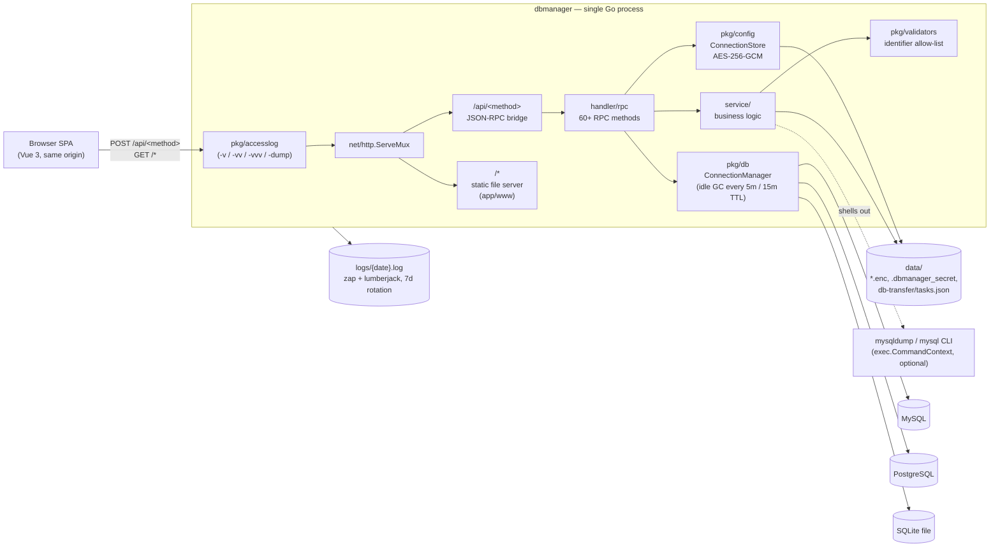

# UrSchema Backend — Architecture

## Overview

The UrSchema backend is a single self-contained Go binary that exposes a JSON-RPC-over-HTTP
API for connecting to and administering MySQL, PostgreSQL, and SQLite databases, and serves
the built Vue frontend from the same process. There is no separate API gateway, load balancer,
or application server — one binary, one process, one TCP port.

The primary goal is a **zero-dependency, self-hosted database client**: a single executable
you copy to a server (or run on a laptop) that needs nothing but a filesystem and network
access to the target databases. This is a deliberate departure from a typical "cloud service"
backend, so several sections below (cloud provider, staging/production URLs, IAM/VPN) don't
apply and are called out as such rather than invented.

## Architecture Diagram



Everything left of the target databases runs in one OS process. `ConnectionManager` holds
live `*sql.DB` handles in memory only — connection state does not survive a process restart,
so the frontend must always re-`db.connect` (or rely on its automatic recovery, see the
frontend doc) after a restart.

## Core Components

| Path | Responsibility |
|---|---|
| `main.go` | Entrypoint: flag parsing (`-v`/`-vv`/`-vvv`/`-dump`), idle-connection cleanup routine, graceful shutdown on SIGINT/SIGTERM. |
| `handler/rpc/server.go` | Builds the `net/http.ServeMux`, wires `/api/` to the JSON-RPC bridge and `/` to the static frontend, strips `URSCHEMA_BASE_PATH` when present, wraps everything in `pkg/accesslog` and, outermost, `pkg/proxy`. |
| `handler/rpc/*.go` | ~14 handler files registering 60+ RPC methods (connections, databases, schemas, tables, table designer/DDL, queries, row CRUD, import/export, dump tasks, filesystem browsing). |
| `service/*.go` | Business logic per domain: `database_service`, `table_service`, `table_designer_service` (DDL diffing), `import_export_service`, `database_dump_service` (mysqldump/CLI + pure-Go paths), `database_compatible_export_service`, `database_dump_task_service` (background export/import task queue). |
| `pkg/db` | `DBConnection` interface + MySQL/PostgreSQL/SQLite adapters, and the in-memory `ConnectionManager` (idle eviction, graceful shutdown). |
| `pkg/config` | `ConnectionStore`: AES-256-GCM encrypted, file-backed store of saved connection configs, plus the read-only connections from `URSCHEMA_CONNECTIONS_FILE` (`presets.go`); resolves the runtime data directory (`DataDir()`). |
| `pkg/validators` | Identifier allow-list validation + per-dialect escaping, used wherever table/column names are interpolated into DDL (defense in depth against injection via identifiers — see Security below). |
| `pkg/accesslog` | Apache-style access logging middleware (`-v` common, `-vv` combined, `-vvv` headers, `-dump` full payloads) — added in this codebase's most recent iteration. |
| `pkg/proxy` | `URSCHEMA_TRUSTED_PROXIES`: for requests from a trusted proxy, sets `RemoteAddr` to the client from `X-Forwarded-For` and decides whether `X-Forwarded-Proto` is believed. |
| `pkg/files`, `pkg/rpcutil` | Small filesystem and RPC-param-parsing helpers. |
| `i18n/en.ini` | Backend error-message catalog (`gi18n`), key-based so more languages are additive. |

**Runtimes / key dependencies** (see `go.mod`): Go **1.24.0**; `github.com/DemonZack/simplejrpc-go`
(JSON-RPC dispatch primitives, zap logger, ini-based config, i18n); `github.com/gorilla/handlers`
(Apache log formats); `github.com/go-sql-driver/mysql`, `github.com/lib/pq`,
`modernc.org/sqlite` (pure-Go SQLite — no CGO, confirmed by `CGO_ENABLED=0` in the Makefile
cross-compile targets); `github.com/sourcegraph/jsonrpc2`; `github.com/google/uuid`.

**Hosting / cloud provider:** none. This is intentionally not tied to any cloud platform —
it's distributed as `linux/amd64` and `linux/arm64` tarballs (`make package`) and run wherever
the operator chooses (bare metal, VM, container you build yourself — no Dockerfile exists in
the repo today).

## Environments

There is no fixed set of Development/Staging/Production URLs — UrSchema is distributed as a
binary, not deployed to owned infrastructure, so "environment" here means *how the same code
is invoked*, not *which servers it's pinned to*:

| Environment | How it's started | Notes |
|---|---|---|
| Development | `cd backend && make start` (or `go run .`), `PORT` env (default `8080`) | Runs backend + Vite dev server concurrently; `www/dist` usually absent, so the backend logs "serving API only" and the Vite dev server serves the SPA instead. |
| Packaged / self-hosted | `make package` → extract tarball → run `app/bin/main` | `app/www` is bundled, so the same binary serves the UI directly; still binds `:$PORT` (default `8080`) on **all interfaces**, not just localhost. |

**Decision/risk worth flagging:** `handler/rpc/server.go` calls
`core.InitContainer(config.WithConfigEnvFormatterOptionFunc("test"))` — the `"test"` logger
profile from `config.json` (verbose, `stdout: true`) is hardcoded and always selected. The
`"prod"` profile in the same file (`level: error`, `stdout: false`) is defined but never
referenced anywhere in the code, so today there is effectively only one logging profile
regardless of how or where the binary is run.

## Data and Storage

UrSchema has no database of its own for *application* state — MySQL/PostgreSQL/SQLite are the
databases it *manages*, not infrastructure it owns. Its own persistent state is a handful of
files under a runtime **data directory**:

| File | Purpose |
|---|---|
| `.dbmanager_connections.enc` | Saved connection configs, AES-256-GCM encrypted. |
| `.dbmanager_secret` | The 32-byte AES key (hex-encoded, `0600` perms), generated on first run unless `DB_ENCRYPTION_KEY` (64-char hex) is set in the environment. |
| `db-transfer/tasks.json` | Persisted state/logs for background export/import tasks (`database_dump_task_service.go`), so in-flight/completed tasks survive a restart. |
| `logs/{Y-m-d}.log` | zap + lumberjack daily-rotating log file; `rotateBackupLimit: 7`, gzip level 9, `rotateExpire: 1d` (see `config.json`). |

**Where the data directory actually is — verified, and a real gotcha:** `pkg/config.getDataDir()`
derives the path from `os.Executable()`, assuming the packaged layout
(`<root>/app/bin/<exe>` → data at `<root>/data`). This holds for a `make package` build, but
was verified to behave very differently for other ways of running the binary:

- `go run .` (typical dev loop) → the compiled binary lives under Go's build cache, so data
  lands at `$GOCACHE/data` (e.g. `~/.cache/go-build/data`) — **outside the repo**, and easily
  wiped by `go clean -cache`.
- `go build -o dbmanager . && ./dbmanager` run directly from `backend/` → data lands **two
  directories above the repository root** (e.g. `~/dev/projects/data` for a repo checked out
  at `~/dev/projects/UrSchema`), not next to the binary as one might expect.
- The packaged layout (`app/bin/main`, sibling `data/`) is the only case that matches the
  code's own comment.

`.gitignore` ignores `/backend/.dbmanager_connections.enc` at the repo root, which matches
none of the above paths exactly — a sign this assumption has drifted from the code over time.
**Practical takeaway:** only trust the data directory location when running the packaged
binary from its `app/bin/` layout; don't rely on `go run`/ad-hoc `go build` for persistent
local data.

**Backups:** none are automated. Operators are responsible for backing up the data directory
themselves; losing `.dbmanager_secret` makes `.dbmanager_connections.enc` permanently
undecryptable (the store just backs itself up to `*.enc.bak` and starts empty — saved
connections are lost, not recovered).

**File storage / buckets:** none — no S3/GCS-style object storage is used anywhere. Table and
database exports/imports read and write local filesystem paths, chosen either through the
`fs.listDir`-backed server-side file browser or an explicit path; there's no managed "app"
storage bucket beyond the data directory above.

## Network and Security

- **Port:** single HTTP port, `PORT` env var, default `8080`. `http.ListenAndServe(":"+port, ...)`
  binds **all interfaces**, not just `127.0.0.1` — there is no bind-address flag today.
- **TLS:** none built in. Anything beyond localhost access needs a TLS-terminating reverse
  proxy in front of it.
- **AuthN/AuthZ:** **there is none.** Every RPC method is registered via
  `ds.RegisterHandle(name, handler)` with no middlewares, even though the underlying framework
  supports per-method middleware (`gsock.RPCMiddleware`,
  `WithJsonRpcSimpleServiceMiddlewares`) — it's simply not used. Treat the backend as a
  trusted-network-only tool; do not expose the port to an untrusted network without adding
  auth at the reverse-proxy layer.
- **Filesystem exposure:** `fs.listDir` (used to power the server-side file/folder picker for
  import/export) lets any caller that can reach the port browse the *entire* server
  filesystem with no jail/root restriction. Combined with the lack of auth above, this is the
  single biggest reason not to bind this service to a non-trusted network.
- **Credential handling:** saved connection passwords are encrypted at rest (AES-256-GCM,
  `pkg/config`), but travel in plaintext between browser and backend over the RPC channel
  unless TLS is added externally (see the frontend's "security notice" copy, which makes this
  assumption explicit to the user).
- **External process execution:** MySQL dump/restore shells out to the `mysqldump`/`mysql` CLI
  (`exec.CommandContext` in `database_dump_service.go`) — these must be installed and on
  `PATH` on the host for full-fidelity MySQL export/import; PostgreSQL/SQLite and CSV/JSON
  paths use a pure-Go fallback (`database_compatible_export_service.go`) and don't need any
  external binary.
- **Access-log flags as a sensitivity surface:** `-vvv` and `-dump` (this session's addition,
  see `pkg/accesslog`) print request/response headers and, for `-dump`, full SQL payloads and
  query results to stdout. That output can include credentials in transit and query result
  data — don't enable it against a shared/aggregated log sink without redaction.
- **IAM / VPN / CORS:** not applicable — there's no cloud IAM, no VPN requirement, and no CORS
  configuration exists or is needed, since the frontend is always served from the same origin
  as the API (see the frontend doc).

## Deployment and Operations

There is **no CI/CD pipeline** configured in this repository (no `.github/workflows` or
equivalent) — builds and releases are manual today.

1. **Dev loop:** `cd backend && make start` — installs missing Go/pnpm deps, then runs the
   backend (`go run .`) and the Vite dev server concurrently; override the port with
   `PORT=8888 make start`.
2. **Release build:** `cd backend && make package` — cross-compiles `linux/amd64` and
   `linux/arm64` (`CGO_ENABLED=0`), builds the frontend, and produces
   `build/linux-<arch>/dbmanager-linux-<arch>.tar.gz` containing:
   ```
   app/bin/     # binary + config.json + i18n/
   app/www/     # built frontend static assets
   data/        # empty; populated at runtime (see Data and Storage)
   logs/        # empty; populated at runtime
   tmp/         # empty
   ```
3. **Deploy:** extract the tarball anywhere and run `app/bin/main` (directly, under `systemd`,
   in a container you build yourself, etc.). Optional env/flags: `PORT`, `DB_ENCRYPTION_KEY`
   (64-char hex, useful for multi-instance/Kubernetes-style secret injection instead of the
   generated key file), and the access-log flags `-v`/`-vv`/`-vvv`/`-dump[=text|json]`.
4. **Health check:** `POST /api/ping` → `{"code":200,"data":"pong",...}`. There is no separate
   metrics/readiness endpoint.
5. **Logs:** `logs/{date}.log` next to the binary (daily rotation, 7 backups, gzip). For
   ad-hoc HTTP-level tracing, run with `-v`/`-vv`/`-vvv`/`-dump` (stdout; see Security above
   before enabling `-dump` anywhere sensitive).

## Troubleshooting and Contacts

| Symptom | Likely cause / fix |
|---|---|
| `listen tcp :8080: bind: address already in use` | Another process (often a previous unkilled run) already holds `PORT`; pick a different `PORT=` or stop the other process. |
| `mysqldump command not found, please install MySQL client tools on the server` | The `mysqldump`/`mysql` CLI isn't on `PATH`; install MySQL client tools, or use CSV/JSON export instead of the mysqldump-compatible path. |
| `frontend directory <path> not found, serving API only` | `app/www` (packaged) or `../www` (dev) doesn't exist yet; run `make frontend` / `pnpm build`, or ignore if you only need the API. |
| `cannot decrypt connections file` (logged as a WARNING) | The AES key changed (moved the binary without `.dbmanager_secret`, or a different `DB_ENCRYPTION_KEY` is now set). The old file is renamed to `*.enc.bak` and a fresh empty store is created — previously saved connections must be re-added. |
| Saved connections/tasks seem to "disappear" between dev runs | Almost always the data-directory resolution quirk described above; run the packaged binary from its `app/bin/` layout for stable storage, not `go run`/an ad-hoc `go build`. |

**Contacts:** this is a single-maintainer open-source project (see `LICENSE`) — there is no
on-call rotation or dedicated ops contact. Use the project's GitHub issue tracker for bugs and
questions.
