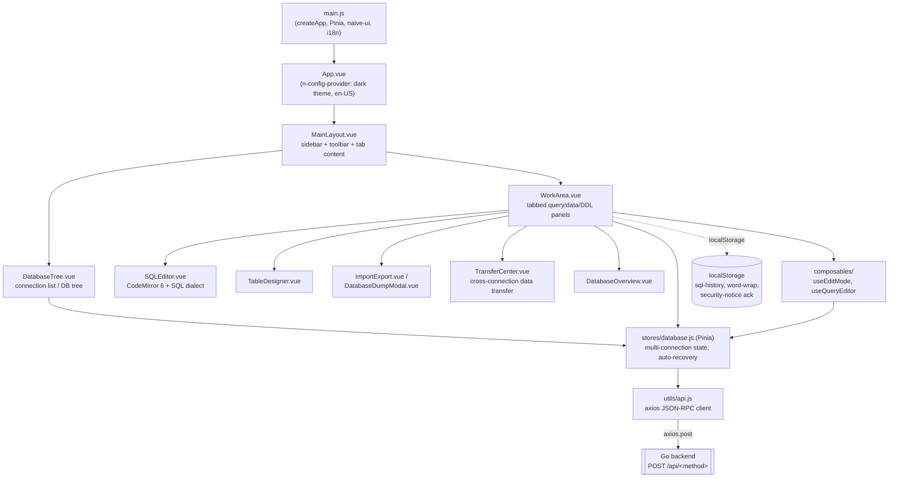

# UrSchema Frontend — Architecture

## Overview

The UrSchema frontend is a Vue 3 single-page application that is the only client for the
backend's JSON-RPC API — there is no separate mobile app, CLI, or third-party API consumer to
account for. It renders a Navicat/DBeaver-style connection tree, SQL editor, table grid, and
DDL designer, and talks to the Go backend exclusively through same-origin HTTP calls to
`/api/<method>`.

The primary goal is a **lightweight, dependency-free UI that ships embedded in the backend
binary**: in production there is no separate frontend host, CDN, or deployment target — the
built assets (`www/dist`) are copied into the backend's package and served by the same Go
process that answers the API calls (see the backend doc). Because of that, several of the
usual "frontend infra" concerns (its own environments/URLs, its own CI/CD, CORS, a client-side
router) either don't exist here or exist in a much simpler form than usual — called out
explicitly below rather than assumed.

## Architecture Diagram

There is **no client-side router** (`vue-router` is a declared `package.json` dependency but
is never imported or used anywhere in `src/` — a leftover/dead dependency worth removing in a
cleanup pass, not something actively wired up). Navigation is entirely state-driven: one
`MainLayout` renders a sidebar, a toolbar, and a tab strip inside `WorkArea`, and switching
"pages" just means switching reactive state, not routes.

## Core Components

| Component | Responsibility |
|---|---|
| `App.vue` | Naive UI providers (dark theme only — no light-mode toggle, matches the README's "ships with a dark theme by default"), locale, mounts `MainLayout`. |
| `views/MainLayout.vue` | Top-level shell: sidebar (`DatabaseTree`), toolbar (Connect / Query / Transfer buttons + connection switcher), and the `WorkArea` content region. |
| `components/DatabaseTree.vue` | Connection list and database/table tree (largest single-purpose tree component, ~2000 lines). |
| `components/WorkArea.vue` | By far the largest component (~3300 lines): tabbed query editor + results grid, data-browsing grid with inline CRUD, and the toolbar wiring for each tab (Run/Stop/History/Format SQL/Word Wrap). |
| `components/SQLEditor.vue` | CodeMirror 6 wrapper: SQL dialect-aware highlighting/completion (MySQL/PostgreSQL/SQLite via `@codemirror/lang-sql`), active-statement highlighting, `Ctrl+Enter`/`F8` to execute, and a `wordWrap` prop toggling `EditorView.lineWrapping` via a `Compartment`. |
| `components/SQLHistoryPanel.vue` | Renders/clears the recent-queries list persisted in `localStorage`. |
| `components/TableDesigner.vue` | Visual DDL editor (columns/indexes/foreign keys) with diff preview. |
| `components/ImportExport.vue`, `DatabaseDumpModal.vue` | Table-level (CSV/JSON/SQL) and database-level (mysqldump-compatible or pure-Go) import/export flows, including the async task-progress UI backed by the backend's dump-task API. |
| `components/TransferCenter.vue` | Cross-connection data transfer (moving data between two configured connections, not just to/from a file). |
| `components/DatabaseOverview.vue` | Table/view listing with row count, size, engine, DDL preview. |
| `components/ServerFilePicker.vue` | UI for the backend's `fs.listDir`-powered server-side file browser (see backend security notes — this is why that RPC method exists). |
| `components/ConnectionForm.vue`, `DatabaseConnection.vue`, `FormModal.vue` | Connection create/edit form (with the one-time, `localStorage`-gated "your credentials are encrypted server-side" notice) and a shared modal wrapper. |
| `composables/useEditMode.js`, `useQueryEditor.js` | Extracted inline-cell-editing logic shared between the data-browsing grid and query-result grid (selection, pending edits, keyboard navigation). |
| `stores/database.js` | Pinia store; see State Management below. |
| `stores/theme.js` | Theme-related state (the app is dark-only today; this is the seam for future theming, not an active light/dark switch). |
| `utils/api.js` | The only place that calls the backend; see Network below. |
| `i18n/en-US.js` | Single-locale (`en-US`) message catalog — matches the backend's key-based i18n design, but only one language is wired up on the frontend today (`i18n/index.js` registers just `en-US` with `en-US` as both `locale` and `fallbackLocale`). |

### State management

`stores/database.js` is a single Pinia store keyed internally by backend-issued `connId`
(`activeMux: Record<connId, ConnectionState>`), which is what lets the UI hold **multiple
simultaneous connections/tabs** open against different databases at once — `currentConnId`
just selects which one the toolbar/tree currently point at. Each `ConnectionState` tracks its
own databases/tables/selected-table/table-data/schema independently.

**Client-driven connection recovery** (in `utils/api.js`, wired to the store's
`recoverConnection` via `api.setConnectionRecoveryHandler`): if an RPC call fails with a
"connection not found" error (e.g. the backend process restarted and lost its in-memory
`ConnectionManager` state — see the backend doc), the client automatically re-issues
`db.connect` with the last-known config, remaps the stale `connId` to the new one via an
alias map, and retries the original call once. It's capped at 2 attempts per `connId` with a
30-second cooldown after a failed recovery, to avoid retry storms against a genuinely-down
backend. Worth knowing when debugging: a backend restart is largely invisible to the user
*unless* recovery is exhausted, in which case the symptom is a `connection not found` error
surfacing normally.

## Environments

There's no independent frontend "environment" tier (no staging/production URLs of its own) —
the built assets are always embedded in whichever backend build serves them, so the frontend's
effective environment is determined by the backend it's paired with:

| Mode | How it runs | Notes |
|---|---|---|
| Development | `pnpm dev` (Vite, port `5173`) or `cd backend && make start` (runs both together) | `vite.config.js` proxies `/api/*` to `http://127.0.0.1:${BACKEND_PORT \|\| 8080}` — `BACKEND_PORT` must match whatever `PORT` the backend was started with. |
| Production build | `pnpm build` → `www/dist/` | `base: './'` (relative asset paths) so the bundle works when served from any sub-path; consumed directly by the backend's static file server, not hosted separately. |

## Data and Storage

There is no frontend-owned server-side storage — all persistence is either backend RPC state
or the browser's own `localStorage`:

| `localStorage` key | Purpose |
|---|---|
| `sql-history` | Recent executed queries (capped at 50 entries), read/written from both `WorkArea.vue` and `SQLHistoryPanel.vue` — note the cap constant and key are duplicated across those two files rather than shared from one place. |
| `sql-editor-word-wrap` | The query editor's word-wrap toggle, applied to every open query tab. |
| `sqlmanager_hide_security_notice` | Whether the user has dismissed the one-time "connections are encrypted server-side" notice in `ConnectionForm.vue`. |

Everything else — open tabs, in-memory query results, the connection tree — lives only in
Pinia state and is lost on a full page reload. There are no cookies, no IndexedDB, and no
service worker/offline cache.

## Network and Security

- **Same-origin only:** `utils/api.js` always calls `${baseURL}/${method}` with `baseURL = '/api'`
  (relative path) — there is no configurable API base URL and no CORS setup anywhere,
  because the frontend is either proxied (dev) or served by the exact same process it talks
  to (production). This is a simplification, not an oversight: it's only possible because the
  backend always serves both the API and the static assets.
- **No client-side auth:** matches the backend's "no authentication" design (see backend doc).
  The "security notice" shown in `ConnectionForm.vue` is purely informational copy about
  server-side encryption at rest — it is not an access-control mechanism.
- **Credential handling:** connection passwords are held in Pinia state (in memory) while a
  connection is open and sent to the backend on `db.connect`/`db.testConnection`/
  `db.saveConnectionConfig`; they're never written to `localStorage` or logged client-side.
- **IAM / VPN / firewall rules:** not applicable at this layer — whatever network boundary
  protects the backend (see backend doc) is the frontend's boundary too, since they're always
  co-located.

## Deployment and Operations

- **Build:** `cd www && pnpm install && pnpm build` (or `make frontend` from `backend/`, which
  does the same thing and is what `make package` depends on). Output: `www/dist/`.
- **No standalone deployment target:** there is no Dockerfile, static-host config, or CDN
  wiring for the frontend in this repo — it is always shipped embedded inside the backend's
  tarball (`app/www/`, see backend doc's Deployment section) or served straight from `dist/`
  during development by Vite.
- **No CI/CD:** consistent with the backend, no pipeline builds or publishes the frontend
  automatically today.
- **Combined dev/ops workflow:** because the two are only ever run together, day-to-day
  workflow (`make start`, custom ports, logs, health checks) is documented once, in the
  backend architecture doc, rather than duplicated here.

## Troubleshooting and Contacts

| Symptom | Likely cause / fix |
|---|---|
| API calls 404 or hang in dev | `BACKEND_PORT` (used by Vite's proxy) doesn't match the backend's actual `PORT`; restart with matching values, or just use `make start` which wires them together. |
| Toolbar keeps showing "please select a database" / actions silently stop working | The backend process likely restarted and the frontend's auto-recovery (2 attempts / 30s cooldown per `connId`, see above) has been exhausted; reconnect manually via the connection tree. |
| A saved connection's password field is always empty when editing | Expected — `ConnectionStore.ListConnections` on the backend never returns passwords; only `GetConnection` (single lookup, e.g. right before editing) includes it. |
| Query history or word-wrap preference doesn't persist | Check the browser isn't blocking/clearing `localStorage` for the app's origin; both are pure client-side preferences with no backend fallback. |

**Contacts:** same as the backend — single-maintainer open-source project (see `LICENSE`), no
dedicated frontend team or on-call; use the project's GitHub issue tracker.
